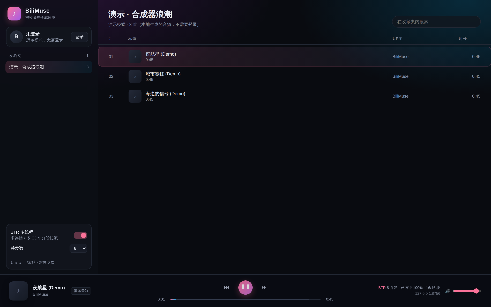

# BiliMuse · 哔哩缪斯

> 把 B 站收藏夹变成私人音乐库的本地播放器，内置 **BTR 多线程 / 多 CDN 流式加速**。
> 网页版、桌面版、安卓版三端可用。



B 站网页版听歌有两个麻烦：一是收藏夹里的视频得一个个点开、关掉画面；二是海外的线路经常单连接只有几百 KB/s，音频还没缓冲完就开始卡。

BiliMuse 把这两件事一起解决：扫码登录后直接列出你的收藏夹，点一下就从视频里抽出音轨来播；拉流不走浏览器的单连接，而是在本地服务端用 BTR 引擎把一段音频切成小块、并发到多个 CDN 节点、按顺序喂给播放器。

## 特性

- **多种登录方式**：扫码，或在桌面版里用账号密码 / 手机验证码登录（内嵌 B 站官方登录页完成极验人机验证，只接收登录 cookie，不保存密码）；登录态只写本机 `~/.config/bilimuse/session.json`（权限 0600）
- **收藏夹即歌单**：列出全部收藏夹、支持夹内搜索、顺序/循环播放、上一首下一首、空格键控制；随机播放会补全整个收藏夹（或全部搜索结果），不会只随机已加载的分页
- **音质优先**：Hi-Res 无损 → 杜比全景声 → 最高码率（192K/132K/64K），有无损就播无损
- **BTR 引擎**：多 Range 并发、多 CDN 节点竞速、慢块对冲、断点续传、按实时速度加权调度
- **起播不等测速**：第一个可用节点先开播，剩下的镜像在后台边测边补进节点池
- **自适应并发**：节点本来就快时自动少开连接（握手也是成本），单连接被限速时才拉满
- **实时指标**：并发数、命中节点、块进度、瞬时速度、对冲次数，播放器右下角直接可见
- **演示模式**：不登录也能跑通整条链路 —— 本地合成三段音频，每条连接限速 320 KB/s，直观对比开关 BTR 的差别
- **桌面版**：Tauri v2 原生窗口 + 打包好的 Python 引擎（边车），不用开浏览器，关窗即退出；支持扫码、账号密码和短信验证码三种登录
- **安卓版**：Kotlin + Compose + Media3 原生 App，BTR 引擎直接作为 ExoPlayer 的 DataSource，支持后台播放、通知栏/锁屏控制和演示模式
- **安卓版自动更新**：启动时静默检查 GitHub Releases，设置页也可手动检查；应用内下载 APK、校验摘要与签名后交给系统安装器（见 [docs/ANDROID.md](docs/ANDROID.md#自动更新github-releases)）
- **多种登录方式（安卓 / 桌面）**：原生扫码，或账号密码 / 手机验证码登录（在内嵌的 B 站官方登录页完成极验人机验证，只接收登录 cookie，不保存密码）
- **零构建**：网页版是 FastAPI + 原生 HTML/CSS/JS，没有 npm、没有打包步骤

## 快速开始

需要 Python 3.10+（开发环境是 3.12）。

```bash
git clone https://github.com/Jackiechen259/bilimuse.git
cd bilimuse

# 先玩演示模式（不需要 B 站账号）
./run.sh --demo

# 真实使用：去掉 --demo，然后浏览器打开 http://127.0.0.1:8756
./run.sh
```

首次运行会自动建 `.venv` 并装依赖。打开页面后点左上角「登录」，用 B 站手机客户端扫码即可。

手动安装：

```bash
python3 -m venv .venv && source .venv/bin/activate
pip install -r requirements.txt
python -m bilimuse --demo          # 或 python -m bilimuse
```

常用参数：

| 参数 | 说明 | 默认 |
| --- | --- | --- |
| `--host` / `--port` | 监听地址与端口；`--port 0` 表示系统分配 | `127.0.0.1:8756` |
| `--demo` | 演示模式，播放本地合成音频 | 关 |
| `--concurrency` | BTR 并发上限 | `8` |
| `--no-btr` | 关闭多线程，走单连接（用于对比） | 关 |
| `--open` | 启动后自动打开浏览器 | 关 |
| `--desktop` | 桌面壳模式：只监听回环、日志静默、就绪后输出 `BILIMUSE_PORT=<port>` | 关 |

也可以直接用环境变量：`BILIMUSE_PORT`、`BILIMUSE_CONCURRENCY`、`BILIMUSE_CHUNK_SIZE`、`BILIMUSE_BTR=0` 等，见 `bilimuse/config.py`。

## 桌面版

不想开浏览器就用桌面版：Tauri 负责窗口，Python 引擎打包成边车随应用启动，
前端页面与网页版完全一致。


```bash
cd desktop
npm install          # 或 pnpm install，只装 Tauri CLI
npm run dev          # 开发运行（首次会自动打包边车，约 30 秒）
npm run build        # 出 .deb / .AppImage
```

Linux 构建需要 webkit2gtk：

```bash
sudo apt install libwebkit2gtk-4.1-dev build-essential curl wget file \
  libxdo-dev libssl-dev libayatana-appindicator3-dev librsvg2-dev
```

登录方式：点「登录」后可以扫码，也可以切到**账号密码**或**短信验证码**。
后两种由桌面壳打开一个独立的 B 站官方 H5 登录窗口（极验人机验证在官方页面里完成），
窗口使用不落地的 incognito 会话；登录成功后桌面壳只读取 `.bilibili.com` 的 cookie
交给边车校验，密码不经过 BiliMuse 代码。

演示模式：`npm run dev -- -- --demo`（或 `BILIMUSE_DEMO=1 npm run dev`）。
桌面版内置基于 GitHub Releases 的自动更新：应用会定期检查新版本，确认后下载并
校验签名安装包，重启即生效。发布流程、签名密钥和平台差异见
[docs/DESKTOP.md](docs/DESKTOP.md#自动更新github-releases)。

## 安卓版

原生 Kotlin 版本：Compose 手机界面 + Media3/ExoPlayer，BTR 引擎直接作为 DataSource 接入，
不需要在手机上跑 Python 或本地 HTTP 服务。支持后台播放、通知栏/锁屏控制、随机/循环、
夹内搜索、分页加载，不登录也可以先玩演示模式。随机播放会自动补全**整个收藏夹**
（或全部搜索结果），不会只随机已经加载过的分页。登录支持**扫码**、**账号密码**和
**手机验证码**：后两种需要 B 站极验，App 内嵌 B 站官方登录页完成验证，成功后只把
登录 cookie 换进原生会话，密码不经过 App 代码。


```bash
cd android
./gradlew :app:assembleDebug
adb install -r app/build/outputs/apk/debug/app-debug.apk

# R8 release 包（未配置正式签名时回退到仓库内 debug key，可直接安装）
./gradlew :app:assembleRelease
```

产物在 `android/app/build/outputs/apk/debug/app-debug.apk`（约 14 MB，minSdk 26，
targetSdk 35）。架构、移植细节、测试与已知限制见 [docs/ANDROID.md](docs/ANDROID.md)。

安卓版内置 GitHub Releases 自动更新：启动时静默检查（可关），设置页里也能手动检查；
下载后校验 APK 的包名、版本与签名，再调起系统安装器。发布流程、versionCode 规则和
签名密钥配置见 [docs/ANDROID.md](docs/ANDROID.md#自动更新github-releases)。


## BTR 是怎么工作的

名字借自 [Bilibili-thread-ripper](https://github.com/MrTangLuyao/Bilibili-thread-ripper)：**把一条大请求拆成很多小段，分散到多条连接、多个节点上并发拿下，再按顺序拼回去**。

浏览器里的 `<audio>` 只能整段拉流、一条连接到底，所以真正的并发放在服务端：前端只连本地 `/api/stream/<id>`，服务端负责把远程音频"多线程"地取回来。（安卓版没有本地服务端，同样的并发放在 App 内的 Media3 DataSource 后面。）

一次取流的完整流程：

1. **取流**：`playurl` 拿到 dash 音频流。挑选顺序是 Hi-Res 无损 → 杜比 → 最高码率。
2. **探测节点**：同一段音频的 path/query 在多个 CDN host 上是通用的，把备份地址 + 已知镜像 host 拼成候选列表，每个节点实测 64 KB，拿到**真实吞吐**和 TTFB。只换 host 的镜像里有大量"响应很快但被限速到 5 KB/s"的坑，不实测就会被它拖死。
3. **不等全部测完**：第一个真正能用的节点先把流交出去开播，剩下的探针在后台继续测，谁测完谁进节点池 —— 九个候选里常有一两个连得上却不回包，等它们就是白等 3 秒超时（实测：3.1s → 0.2s）。
4. **过滤慢节点**：低于最快节点 60% 的直接踢出节点池 —— 按序输出时，一个慢块就能卡住整条流水线。
5. **分块**：块大小按文件长度折中（128 KB ~ 512 KB）。块越小起播越快，但请求开销也越大。
6. **加权调度**：按实测速度的平方加权选节点，快的多拿块，同时保留少量探索，防止"先给速度、后限速"的节点被永久选中。
7. **对冲**：某块超过预期耗时 2 倍还没回来，就换一个节点重发同一段，谁先到用谁，另一个取消 —— 只在这块可能赶不上播放时才浪费这份带宽。
8. **续传**：连接中途断掉时，记下已收到的字节数，从断点续 Range，不整块重来。
9. **自适应并发**：目标吞吐 4 MB/s。节点本身很快就没必要开 8 条连接（握手要几百毫秒，反而更慢）；一旦出现慢块或断流，并发自动往上加，直到用户设定的上限。

对外仍然是一个普通的 Range 流：支持 `206 Partial Content`，所以进度条拖动、切歌、浏览器自己的预读都正常。

### 可复现的对比

本地假 CDN，每条连接限速 488 KB/s，4 MB 文件：

```
单连接: 8.71s (0.46 MB/s)
BTR   : 1.25s (3.19 MB/s)，并发 8，块 256 KB
加速 6.9x，字节一致: True
```

```bash
PYTHONPATH=. .venv/bin/python scripts/bench_mock.py
```

起播延迟（9 个候选里 8 个"连得上但不回包"）：

```
等全部测完: 3119 ms
抢跑      :  199 ms
```

```bash
PYTHONPATH=. .venv/bin/python scripts/bench_probe.py
```

真实 B 站视频抽样（2 MB 区间，同一音轨）：

| 视频 | 单连接 | BTR | 倍数 |
| --- | --- | --- | --- |
| BV1chxT6xEyo | 4.43s (462 KB/s) | 0.25s | **18.1x** |
| BV1xtxu6KEaz | 2.31s (885 KB/s) | 0.41s | **5.7x** |
| BV1znxg6fEKA | 0.17s | 0.12s | 1.4x |
| BV1AtxT6tETW | 0.92s | 1.80s | 0.5x |

最后一行是诚实的一部分：**当单条连接本身就能跑满（十几 MB/s）时，BTR 反而慢几十到几百毫秒** —— 多开连接要握手、要探测。所以并发是自适应的，而不是固定拉满；真正需要它的场景是"单连接只有几百 KB/s、换个节点就快"的跨境线路。

### 运行时

网页版默认装 `uvloop`（事件循环）和 `httptools`（HTTP 解析）：本地代理一条音轨要发十几次 Range 请求，C 实现比纯 Python 省 10~15% CPU。桌面包**不**打包 uvloop —— 那个 `.so` 会让边车多 5 MB、启动慢 ~100 ms，而换来的那点 CPU 在单条本地流上可以忽略。`/api/health` 会报当前实际用的组合：

```json
{"ok": true, "runtime": {"loop": "uvloop", "http": "httptools"}}
```

## 项目结构

```
bilimuse/
├── bilimuse/
│   ├── api.py          # B 站 Web API：扫码登录、收藏夹、playurl（含 WBI 签名）
│   ├── auth.py         # 登录态本地存储（0600）
│   ├── btr.py          # BTR 引擎：节点探测、分块调度、对冲、续传
│   ├── server.py       # FastAPI：扫码 / 桌面官方窗口登录 / 收藏夹 / 取流 / Range / 统计
│   ├── launcher.py     # 端口绑定 + uvicorn 启动（支持 --port 0 与桌面模式）
│   ├── demo.py         # 演示音频合成（4 秒循环拼接，秒级生成）
│   ├── config.py       # 配置与路径（含 PyInstaller 冻结路径）
│   ├── web/            # 前端：index.html / app.js / style.css
│   └── __main__.py     # 命令行入口
├── desktop/            # Tauri v2 桌面壳（Rust + 启动页）
│   ├── web/index.html  # 启动页
│   └── src-tauri/      # 窗口、边车生命周期、登录桥（login.rs）、打包配置、图标
├── android/            # 安卓版：Kotlin + Compose + Media3
│   ├── app/src/main/kotlin/com/bilimuse/app/
│   │   ├── btr/        # BTR 引擎 Kotlin 移植
│   │   ├── data/       # WBI 签名、B 站 API、登录态、演示 CDN、自动更新
│   │   ├── player/     # MediaSessionService / MediaController / DataSource
│   │   └── ui/         # Compose 界面
│   └── app/src/test/   # 39 个 JVM 测试
├── scripts/            # 基准脚本 + 边车打包 / 图标生成
├── tests/              # 测试：引擎正确性、限速场景提速、断流恢复、Range、启动器
└── docs/               # ARCHITECTURE.md / DESKTOP.md / ANDROID.md
```

## API

| 方法 | 路径 | 说明 |
| --- | --- | --- |
| `GET` | `/api/state` | 登录态、版本、当前引擎设置 |
| `POST` | `/api/login/qr` | 生成二维码（返回 SVG data URI） |
| `GET` | `/api/login/poll?key=` | 轮询扫码状态：pending / scanned / success / expired |
| `POST` | `/api/desktop/login/request` | 桌面版：发起官方登录窗口（`{"mode":"password"}` 或 `"sms"`） |
| `GET` | `/api/desktop/login/pending` | 桌面壳：领取待打开的登录请求（无请求返回 204） |
| `POST` | `/api/desktop/login/cookies` | 桌面壳：回传官方登录页的 cookie，校验并保存登录态 |
| `GET` | `/api/desktop/login/status?request_id=` | 前端：轮询登录进度 |
| `POST` | `/api/desktop/login/cancel` | 取消 / 关闭登录窗口 |
| `POST` | `/api/logout` | 清本地登录态 |
| `GET` | `/api/folders` | 收藏夹列表 |
| `GET` | `/api/folder/{fid}?pn=&ps=&keyword=` | 收藏夹内容（分页 / 搜索） |
| `POST` | `/api/track` | 解析音轨：`{"bvid": "..."}` → 流 ID、大小、音质、节点数 |
| `GET/HEAD` | `/api/stream/{id}` | 音频流，支持 `Range` |
| `GET` | `/api/stats/{id}` | 引擎实时指标（节点、块、速度、对冲） |
| `GET/POST` | `/api/settings` | 开关 BTR、并发数、块大小、无损偏好 |

## 测试

```bash
.venv/bin/python -m pytest -q      # 39 passed
```

桌面登录桥（回环 HTTP 解析 / chunked / cookie 域过滤）另有 7 个 Rust 单元测试：

```bash
cd desktop/src-tauri && cargo test --release login
```

安卓版的引擎、WBI 签名、演示 CDN、音轨选择和自动更新另有 39 个纯 JVM 测试（不需要模拟器）：

```bash
cd android && ./gradlew :app:testDebugUnitTest
```

测试用一台"每条连接限速 500 KB/s"的假 CDN 验证：字节完全一致（sha256）、并发确实更快（>2.5x）、一个节点反复断流时依然能靠另一个节点拼出完整数据，以及"连得上但不回包"的节点不会拖慢起播。

## 已知限制

- Hi-Res / 杜比音轨需要大会员账号，普通账号最高 192K
- 番剧、付费课程、部分版权内容拿不到 dash 流，会返回错误
- 只读收藏夹，不做收藏 / 投币 / 评论等写操作
- 默认只监听 `127.0.0.1`，**不要直接暴露到公网**：它是一个带登录态的本机代理
- 单进程内存缓存 48 条音轨的流信息（不含音频数据）

## Roadmap

- [ ] 播放队列持久化 + 自定义歌单（三端共享设计）
- [ ] 收藏夹增量同步（只看新增的稿件）
- [ ] 本地缓存已听过的音轨，二次播放零等待
- [x] 桌面壳（Tauri v2 + Python 边车，见 `desktop/`）
- [x] 安卓版（Kotlin + Compose + Media3，见 `android/`）
- [ ] 桌面端单实例 / 托盘 / 全局快捷键（已接 Media Session，桌面壳再接一层）
- [x] 桌面端的账号密码 / 短信验证码登录（桌面壳内嵌官方登录窗口 + cookie 交换，见 `desktop/src-tauri/src/login.rs`）
- [ ] 网页版的账号密码 / 短信登录（需要常驻浏览器壳；目前请扫码）

## 声明

仅供个人学习与技术研究。音频来自 B 站公开接口，仅用于本人账号收藏内容的在线收听，不提供下载、转存或再分发功能；请遵守 B 站用户协议与当地法律法规。BTR 的名字与思路来自 [Bilibili-thread-ripper](https://github.com/MrTangLuyao/Bilibili-thread-ripper)，本项目是独立的 Python / Kotlin 实现。

MIT License.
