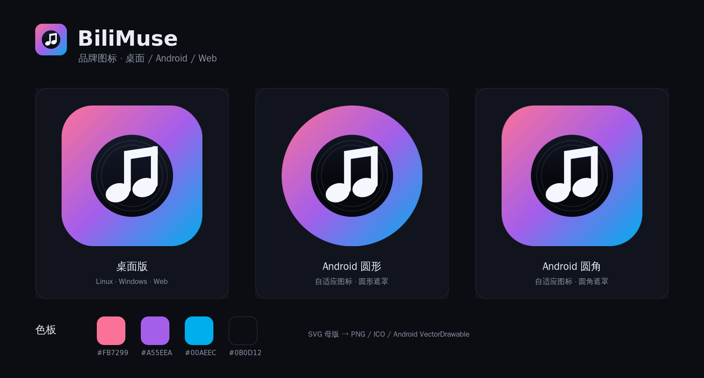

# BiliMuse 品牌图标



## 设计

- **黑胶唱片 + 连杠八分音符**：唱片代表「收藏夹 / 音乐库」，连杠音符代表「播放列表」，也延续了桌面版原来的双音符记忆点。
- **B 站渐变**：`#FB7299`（粉）→ `#A55EEA`（紫）→ `#00AEEC`（蓝），与播放器界面的主色一致。
- **深色底**：`#0B0D12` 作为唱片、界面和启动页的底色，让白音符在小尺寸下仍有足够对比度。
- **同一套坐标**：桌面版和 Android 都用 108×108 的画布描述这个图形；Android 自适应图标的前景整体缩放 2/3，以适配 72dp 的可见安全区，所以启动器里看到的唱片/音符比例与桌面版一致。
- **小尺寸简化**：16/24px 的 Windows 图标和 favicon 去掉唱片，只保留深色音符，避免小尺寸糊成一团。

## 文件

| 文件 | 用途 |
| --- | --- |
| [`bilimuse-icon.svg`](bilimuse-icon.svg) | 主图标母版：渐变圆角方块 + 黑胶唱片 + 白音符 |
| [`bilimuse-mark.svg`](bilimuse-mark.svg) | 透明底的唱片 + 音符，供网页 logo 等场景复用 |
| [`bilimuse-favicon.svg`](bilimuse-favicon.svg) | 小尺寸简化版：渐变方块 + 深色音符 |
| [`bilimuse-monochrome.svg`](bilimuse-monochrome.svg) | Android 13+ 主题图标的单色轮廓参考 |
| [`icon-preview.png`](icon-preview.png) | 桌面 / Android 圆形 / Android 圆角预览 |
| [`icon-sizes.png`](icon-sizes.png) | 128 / 64 / 32 / 16px 与 favicon 的对比 |

Android 端不是直接引用 SVG，而是同一套几何的 VectorDrawable：

- `android/app/src/main/res/drawable/ic_launcher_foreground.xml`
- `android/app/src/main/res/drawable/ic_launcher_background.xml`
- `android/app/src/main/res/drawable/ic_launcher_monochrome.xml`
- `android/app/src/main/res/drawable/ic_splash.xml`

修改图形时请同时更新 SVG 母版和这四个 VectorDrawable，保持坐标一致。

## 色板

| 名称 | 色值 |
| --- | --- |
| Bili 粉 | `#FB7299` |
| 过渡紫 | `#A55EEA` |
| Bili 蓝 | `#00AEEC` |
| 深色底 | `#0B0D12` |
| 音符白 | `#F5F7FF` |

## 重新生成

桌面版 PNG / ICO 和网页 favicon 都由 SVG 母版生成：

```bash
pip install cairosvg
python scripts/make_icon.py
```

输出：

- `desktop/src-tauri/icons/*.png`、`icon.ico`
- `bilimuse/web/favicon.svg`、`favicon.ico`

`icon-preview.png` 和 `icon-sizes.png` 是排版好的预览图，不参与构建；需要时用 ImageMagick 重新拼接即可。
