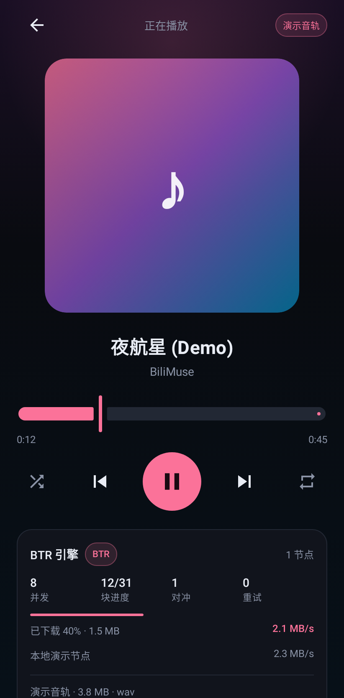
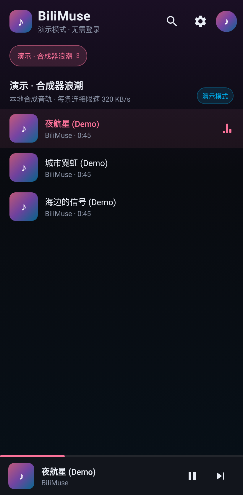

# 安卓版（Kotlin + Compose + Media3）



收藏夹与迷你播放器：



安卓版不是一个"套壳网页"，而是把播放链路原生化：

- UI 用 **Jetpack Compose** 重写，适配手机、支持锁屏/通知栏/蓝牙控制；
- 播放器用 **Media3 ExoPlayer**，通过自定义 `DataSource` 直接吃 BTR 引擎的输出；
- BTR 引擎、WBI 签名、扫码登录、收藏夹、playurl 全部 **用 Kotlin 重写**，不依赖 Python；
- 账号密码 / 手机验证码登录通过 App 内嵌的 B 站官方 H5 登录页完成（极验人机验证在官方页里），成功后只导入 cookie；
- 不需要在手机上跑本地 HTTP 服务，也不需要浏览器。

## 整体结构

```
┌──────────────────────────── Android App ─────────────────────────────┐
│  Compose UI                                                          │
│    LibraryScreen / NowPlayingScreen / LoginDialog / SettingsSheet     │
│         │                                                            │
│  MainViewModel  ──→  BiliClient（OkHttp + WBI 签名 + Cookie）          │
│         │                 └──→ B 站 Web API                          │
│         │                                                            │
│  PlayerController（MediaController）                                  │
│         │                                                            │
│  PlaybackService（MediaSessionService，前台服务）                      │
│         │                                                            │
│  ExoPlayer ──→ BtrDataSource ──→ StreamRegistry ──→ BTR 引擎          │
│                                                   │                  │
│                                                   └──→ 多个 CDN 节点   │
└──────────────────────────────────────────────────────────────────────┘
```

和网页版"本地 HTTP 服务 + `<audio>`"最大的区别：

| | 网页版 / 桌面版 | 安卓版 |
| --- | --- | --- |
| 播放器 | 浏览器 `<audio>` 请求本地 `/api/stream` | ExoPlayer 通过 `BtrDataSource` 直接读取 |
| 多线程 | 服务端按 Range 并发拉流 | 引擎按块并发拉流，DataSource 顺序吐字节 |
| 拖动进度条 | HTTP Range 重开连接 | ExoPlayer `seek` → 关闭旧 reader、按新 position 新建 reader |
| 后台播放 | 浏览器标签页 | 前台 Service + MediaSession，通知栏/锁屏可控 |
| 鉴权存储 | `~/.config/bilimuse/session.json`（0600） | 应用私有 SharedPreferences（`allowBackup=false`） |

## 为什么不塞一个 Python 边车

桌面版可以带 Python 边车，但安卓上要么用 Chaquopy（APK 多 ~50 MB、启动慢、
pydantic-core 等原生依赖适配麻烦），要么为了一个本地 HTTP 端口再起一套服务。
BTR 的核心是 OkHttp + 协程就能表达的 HTTP 分块与调度，重写的可控性更高；
而且直接做 Media3 的 `DataSource` 还能省掉一次本地 HTTP 转发。

## 目录

```
android/
├── settings.gradle.kts / build.gradle.kts
├── gradle/                    # Gradle wrapper
├── gradlew / gradlew.bat
├── keystore/
│   └── bilimuse-debug.jks     # 只用于 debug APK，可直接 sideload
├── app/src/main/kotlin/com/bilimuse/app/
│   ├── btr/                   # BTR 引擎（bilimuse/btr.py 的 Kotlin 移植）
│   │   ├── BtrModels.kt       # Source / CdnPool / Stats / Snapshot
│   │   └── BtrEngine.kt       # probe / buildStream / hedging / reader
│   ├── data/
│   │   ├── Wbi.kt             # WBI 签名（与 Python 实现逐字节一致）
│   │   ├── BiliClient.kt      # 扫码登录 / 收藏夹 / playurl / 音轨选择
│   │   ├── SessionStore.kt    # 登录态持久化
│   │   ├── SettingsStore.kt   # BTR 设置持久化
│   │   ├── DemoCdn.kt         # 演示模式：合成 WAV + 限速 Interceptor
│   │   └── StreamRegistry.kt  # 30 分钟 / 48 条音轨缓存，懒解析
│   ├── player/
│   │   ├── PlaybackService.kt # MediaSessionService + ExoPlayer
│   │   ├── PlayerController.kt# UI ↔ MediaController 桥
│   │   └── BtrDataSource.kt   # Media3 DataSource
│   ├── ui/                    # Compose 界面、主题、登录/设置弹层
│   ├── MainViewModel.kt
│   └── MainActivity.kt
└── app/src/test/kotlin/...    # JVM 测试（不需要模拟器）
```

## 环境要求

- JDK 17（AGP 8.7 / Gradle 8.11 的要求）
- Android SDK Platform 35、Build-Tools 35
- 构建机器能访问 Google Maven / Maven Central

`android/local.properties` 里写 SDK 路径（该文件不入库）：

```properties
sdk.dir=/home/you/Android/Sdk
```

也可以只设 `ANDROID_HOME`。没有 `local.properties` 时 Gradle 会读 `ANDROID_HOME`。

## 构建与安装

```bash
cd android

# 调试包（用仓库内自带的 debug 签名，可直接安装）
./gradlew :app:assembleDebug

# 产物
# android/app/build/outputs/apk/debug/app-debug.apk

adb install -r app/build/outputs/apk/debug/app-debug.apk

# R8 release 包（未签名，约 2.4 MB；签名配置后才会产出可安装的 release APK）
./gradlew :app:assembleRelease
```

第一次构建会下载 Compose、Media3、OkHttp、Coil、ZXing 等依赖，约 1–3 分钟。

跑 JVM 测试（不需要手机或模拟器）：

```bash
./gradlew :app:testDebugUnitTest
```

CI 或没有 `~/.android/debug.keystore` 的环境也能直接构建：`app/build.gradle.kts`
里的 debug 签名指向 `android/keystore/bilimuse-debug.jks`（这是公开的调试密钥，
**不要用它签名正式发布包**）。要打 release 包请自己配置 `signingConfig`。

## 功能

- 三种登录：原生扫码；账号密码 / 手机验证码（B 站官方登录页 + 极验人机验证）
- 登录态只写应用私有目录；密码和短信验证码只在官方登录页内处理，App 不保存
- 收藏夹列表、夹内搜索、分页加载（每页 30 条）
- 点击播放、队列、上一首/下一首、拖动进度、随机、单曲循环/列表循环
- 音质优先级：Hi-Res 无损 → 杜比全景声 → 最高码率
- BTR 开关、并发数（2–24）、分块大小（256 KB / 512 KB / 1 MB）、无损优先
- 实时引擎指标：节点、并发、块进度、瞬时速度、对冲/重试次数
- 后台播放：锁屏、通知栏、耳机线控/蓝牙按键（MediaSession）
- 演示模式：不登录也能跑通整条播放链路，每条连接限速 320 KB/s，可直观看到 BTR 与单连接的差别

## 登录方式

| 方式 | 实现 | 人机验证 | 说明 |
| --- | --- | --- | --- |
| 扫码 | 原生 `BiliClient` + ZXing | 不需要 | 最快，只把 SESSDATA 等 cookie 写入本机 |
| 账号密码 | WebView 加载 B 站官方 H5 登录页 | 极验，由官方页处理 | App 只读取 cookie，不读取密码输入框 |
| 手机验证码 | 同上 | 极验，由官方页处理 | 发送短信/校验都在官方页里完成 |

B 站的密码登录和短信登录都强制要求极验 `validate`/`seccode`（实测不带验证码直接 POST
返回 `-105 验证码错误`）。在 App 里自己实现极验 SDK 既脆弱又容易踩风控，所以这两种方式
使用官方 H5 页：

1. 打开登录页前清空 WebView 的 cookie / localStorage；
2. WebView 只允许在 `bilibili.com`、`biligame.com`、`hdslb.com`、`geetest.com` 域内导航；
3. 每 1 秒读一次 `CookieManager`，拿到 `SESSDATA` 后交给 `BiliClient.completeLoginFromCookies()`；
4. 临时替换原生 cookie，调 `/x/web-interface/nav` 校验，成功才持久化；失败恢复旧登录态；
5. 关闭 WebView 时销毁实例。App 代码不会读取密码或验证码字段。

“账号密码”入口会自动点一下官方页里的 `.login-type-toggle` 切到密码表单（带重试，
选择器失效也不影响手动点击页面内的“账号密码登录”）。

网页版 / 桌面版目前仍只有扫码登录；它们没有内嵌一个带 cookie 访问权限的官方登录窗口，
要支持密码/短信需要额外的浏览器窗口和 cookie 交换，后续可以再做。

## BTR 移植细节

`bilimuse/btr.py` 里的每个关键行为都保留了：

| Python | Kotlin |
| --- | --- |
| `expand_mirrors()` | `expandMirrors()` |
| `probe()` 64 KB 实测吞吐 | `probe()` + OkHttp `call.timeout(3s)` |
| 首个可用节点抢跑、后台补节点 | `buildStream(eager=true)` + `scope.launch { graft }` |
| `CdnPool.pick()` 速度平方加权 | `CdnPool.pick()`（线程安全，`@Volatile` + 锁） |
| 慢块对冲 | `hedged()` 用 `select` + `withTimeoutOrNull` |
| 断流续传 6 轮 | `download()` 返回已收字节，`chunk()` 从断点续 |
| 自适应并发（目标 4 MB/s） | `assemble()` 计算 `autoConcurrency`，`_rampUp()` |
| 按序输出 | `BtrReader`（有界 `LinkedBlockingQueue` + 协程生产者） |

一个 Kotlin 特有的点：Media3 的 `DataSource.read()` 是阻塞式调用，而引擎是协程。
`BtrReader` 在 IO 线程上跑生产者，按块写入容量 8 的队列，`read()` 从队列取字节；
关闭时取消 job 并唤醒阻塞的读，避免 seek 时残留下载任务。

## 测试

`./gradlew :app:testDebugUnitTest` 共 15 个 JVM 测试：

- **WbiTest**：mixin key、`w_rid`、中文/空格/特殊字符编码与 Python 实现一致
- **BtrEngineTest**：
  - 1 MB 文件、每条连接 400 KB/s：BTR 比单连接快 2 倍以上，字节完全一致
  - 非对齐 `start/end` 的 Range 读取字节精确
  - 一个 1.5 秒不回包的黑洞节点不会拖慢起播
- **DemoCdnTest**：合成 WAV 头正确、Range/Content-Range 正确、字节精确
- **PickAudioTest**：无损优先、关闭无损时选最高码率、无音轨时报错
- **SessionDataTest**：登录态 JSON 序列化/反序列化、cookie 头、未登录判定
- **CookieParsingTest**：WebView Cookie 头解析（值里带 `=`、空项、空白）

测试里的假 CDN 是真正的 `MockWebServer`，按连接限速并支持 Range，不是 mock 引擎内部。

## 已验证

- `:app:assembleDebug` 成功，产物 `app-debug.apk` 约 14 MB
- 15 个 JVM 测试全部通过
- JVM 基准（1 MB 文件、每条连接 400 KB/s）：单连接 ~2.6 s，BTR 645 ms，**约 4.1x**
- 真实 B 站二维码接口冒烟通过：生成 `account.bilibili.com` 扫码 URL，轮询返回 `pending`
- Compose 界面在 Robolectric 中以 411×891 dp 真实渲染通过，截图见 `assets/android*.png`
- `:app:assembleRelease`（R8 + resource shrinking + lintVital）成功，未签名包 2.4 MB
- APK manifest：`com.bilimuse.app`、minSdk 26、targetSdk 35、前台媒体服务与通知权限齐全
- APK 已完成 v2 签名校验（项目内 debug key，可直接 `adb install`）
- 官方 H5 登录页在 411×891 手机尺寸下（Chromium 移动端模拟）实测：默认手机号验证码表单，`.login-type-toggle` 可切到账号密码表单

## 已知限制

- 开发机没有可用的 KVM，**尚未在真机/模拟器上做完整的扫码 → 播放回归**；目前已验证编译、15 个 JVM 测试、真实二维码接口和 Robolectric 界面渲染。第一次装到手机上建议先用「演示模式」确认播放链路
- 账号密码 / 手机验证码依赖 B 站官方 H5 登录页和 WebView；B 站改版时入口选择器可能变化（仍可手动点页面上的入口），必要时退回扫码登录
- 密码 / 短信登录页没有在真机上做完整回归（当前环境没有可用 KVM），WebView 登录页的移动端布局和密码入口已用 411×891 的 Chromium 验证
- 只播第一个分 P（和网页版一致）
- Hi-Res / 杜比需要大会员；杜比（E-AC3）是否可解取决于设备解码器
- 番剧、付费课程、部分版权内容拿不到 dash 音轨
- 暂无离线缓存 / 歌单持久化；换设备不会同步
- 演示音频首次生成约 12 MB，放在应用 cache 目录
- 冷启动时 MediaSession 连接、音轨解析和 CDN 探测叠加，首播会比切歌慢
- 默认不向公网暴露任何端口（安卓版根本没有本地服务端口）

## 故障排查

| 现象 | 原因 / 处理 |
| --- | --- |
| 构建报 `Unsupported class file major version` | Gradle 跑在 JDK 21 但 AGP 需要 17？设置 `JAVA_HOME` 到 JDK 17 |
| `SDK location not found` | 建 `android/local.properties` 或设 `ANDROID_HOME` |
| 通知栏没有播放卡片 | Android 13+ 未授予通知权限；系统设置里打开 |
| 提示“登录已失效” | SESSDATA 过期；重新扫码登录 |
| 音轨解析失败 / 502 | 大会员音轨、番剧、版权内容或 CDN 风控；换一首或重新登录 |
| 演示模式没有声音 | 检查媒体音量；源码里限速只为演示，不会影响真实播放 |
