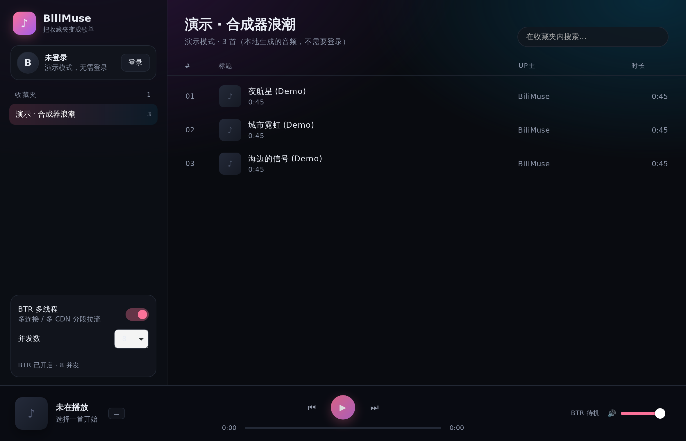

# 桌面版（Tauri v2）

桌面版不是把 Python 逻辑重写一遍，而是给它套一个原生外壳：



```
┌─────────────────────────────── BiliMuse.app / .deb ───────────────────────────────┐
│  Tauri (Rust)                                                                      │
│    · 一个原生窗口，加载本地启动页                                                   │
│    · 拉起并守护 Python 边车（bilimuse-server）                                      │
│    · 拿到端口后把窗口导航到 http://127.0.0.1:<随机端口>/                            │
│                                                                                    │
│  Python 边车（PyInstaller 打包，内含 FastAPI + BTR 引擎 + 前端静态文件）             │
│    · 扫码登录 / 收藏夹 / playurl / 多 CDN 分块拉流                                   │
└────────────────────────────────────────────────────────────────────────────────────┘
```

## 为什么不全部用 Rust 重写

BTR 引擎（节点探测、分块调度、对冲、断点续传、自适应并发）和 B 站 WBI 签名、
扫码登录的边界条件，都在 `bilimuse/` 里并且有测试覆盖。用 Rust 重写一遍等于把
最容易出错的部分重做一次，收益只是"少带一个 Python 运行时"。所以这里选择：

- **前端零改动**：桌面窗口直接加载原有页面，`app.js` 不用改一行；
- **引擎零改动**：`btr.py` / `api.py` / `auth.py` 原样运行在边车里；
- **打包成单文件**：PyInstaller onefile，用户机器不需要装 Python。

代价是安装包会多出 ~20 MB（Python 运行时 + 依赖）。

## 目录

```
desktop/
├── package.json              # @tauri-apps/cli，npm/pnpm 脚本
├── web/index.html            # 启动页（等边车就绪时显示）
└── src-tauri/
    ├── Cargo.toml
    ├── build.rs              # 把 target triple 固化给运行时用
    ├── tauri.conf.json       # 窗口/打包/externalBin 配置
    ├── capabilities/         # Tauri v2 权限（页面不用 IPC，只留 core:default）
    ├── icons/                # scripts/make_icon.py 生成
    ├── binaries/             # 边车产物（不入库）
    └── src/main.rs           # 窗口 + 边车生命周期
scripts/
├── build_sidecar.sh          # PyInstaller 打包边车
├── sidecar_entry.py          # 打包入口（保留包内相对导入）
└── make_icon.py              # 生成图标
```

## 启动时序

1. Tauri 建窗口，加载 `desktop/web/index.html`（深色启动页，不会白屏）。
2. 后台线程执行 `bilimuse-server --desktop --port 0`。
3. Python 先 `bind()` 端口（端口 0 = 内核分配），再启动 uvicorn；
   uvicorn **真正开始 accept 之后**才往 stdout 打 `BILIMUSE_PORT=<port>`。
4. Rust 读到这一行，把窗口导航到 `http://127.0.0.1:<port>/`。
5. 关闭窗口 → 应用退出 → `kill` 边车；如果 Tauri 进程被强杀，
   边车会从 stdin 收到 EOF 自行退出（`launcher.watch_stdin`）。

端口用 0 而不是固定 8756：桌面版可能和网页版同时开着，也可能同时开两份，
固定端口会直接冲突。

## 环境要求

Linux（Ubuntu/Debian）：

```bash
sudo apt install libwebkit2gtk-4.1-dev build-essential curl wget file \
  libxdo-dev libssl-dev libayatana-appindicator3-dev librsvg2-dev
```

另外需要 Rust（1.77+）、Node.js 18+ 和 Python 3.10+（打包边车用；
没有 `.venv` 时 `build_sidecar.sh` 会自动建一个并装依赖）。
macOS 需要 Xcode Command Line Tools，Windows 需要 WebView2（Win10/11 自带）和 MSVC 工具链。

## 开发

```bash
cd desktop
npm install          # 或 pnpm install

# 首次会先打包边车（约 30 秒），之后 --if-needed 会跳过
npx tauri dev

# 演示模式（不登录，播放本地合成音频）
npx tauri dev -- -- --demo
```

`tauri dev -- -- --demo` 里的第一段 `--` 是 tauri 的分隔符，第二段传给应用本身；
也可以直接 `BILIMUSE_DEMO=1 npx tauri dev`。

## 构建安装包

```bash
cd desktop
npx tauri build
```

产物：

- `desktop/src-tauri/target/release/bundle/deb/BiliMuse_0.1.0_amd64.deb`
- `desktop/src-tauri/target/release/bundle/appimage/BiliMuse_0.1.0_amd64.AppImage`

只想要可执行文件（不打包）：`npx tauri build --no-bundle`，产物在
`desktop/src-tauri/target/release/bilimuse-desktop`。

边车会由 `beforeBuildCommand` 自动重新打包，产物名必须带 target triple
（`bilimuse-server-x86_64-unknown-linux-gnu`），这是 Tauri `externalBin` 的约定。

打包时的两个取舍（都在 `scripts/build_sidecar.sh` 里）：

- `--strip`：uvloop 的 `.so` 未 strip 时有 16 MB（压缩后 5 MB），strip 后整个边车
  从 22.5 MB 回到 17.6 MB，启动也快 ~100 ms；
- `--exclude-module uvloop`：桌面版跑 asyncio 事件循环 + httptools 解析器。
  uvloop 只对"每秒几十个本地小请求"有帮助，折算到 4 MB/s 的播放不到 1% 的 CPU，
  不值得为它多背 5 MB 和启动时间。网页版装了就用（`/api/health` 会显示）。

另：`PYINSTALLER_CONFIG_DIR` 默认指到 `build/pyinstaller-cache`，构建不会往
`~/.cache` 里写东西。

## 日志

边车的 stderr 会写到：

```
~/.cache/bilimuse/desktop.log
```

Windows 是 `%LOCALAPPDATA%\bilimuse\desktop.log`。超过 2 MB 会在下次启动时清空。
启动失败时启动页会直接显示错误摘要和日志路径。

## 平台差异

| 平台 | 说明 |
| --- | --- |
| Linux | 已验证 `.deb` 构建与实跑（Ubuntu 24.04）；需要 webkit2gtk-4.1 |
| Windows | 用 `npx tauri build --bundles nsis`；边车产物带 `.exe` 后缀（脚本已处理），子进程用 `CREATE_NO_WINDOW` 防止弹黑框，退出时用 `taskkill /T` |
| macOS | 用 `npx tauri build --bundles app,dmg`；需要 `icon.icns`（`npx tauri icon icons/icon.png` 生成），边车要在 macOS 上重新打包 |

`tauri.conf.json` 里的 `bundle.targets` 是 `["deb", "appimage"]`（Linux 默认）。
在其他平台构建时用 `--bundles` 覆盖即可，不用改配置。

安装 deb：

```bash
sudo apt install ./BiliMuse_0.1.0_amd64.deb
```

安装后启动器里会出现 BiliMuse，可执行文件是 `/usr/bin/bilimuse-desktop`，
边车在 `/usr/bin/bilimuse-server`。

## 已验证

在本仓库的开发机上实际跑通过：

- `cargo build` / `cargo fmt --check` 通过
- `npm run build`（`tauri build --bundles deb`）产出 17.9 MiB 安装包
- 启动后窗口加载真实界面，边车随机端口可用（`/api/health` 返回 0.1.0）
- 演示模式可解析音轨并返回 `206 Partial Content`（BTR 链路可用）
- 关窗后边车进程组在几十毫秒内退出（实测 17–30ms）
- 删掉边车后启动页显示「找不到 Python 引擎」错误提示；引擎崩溃时错误页会带出 stderr 最后几行

## 已知限制

- 还没做单实例：重复启动会开两个窗口、两个边车（端口不同，不冲突）
- 还没做托盘/关闭到后台：关窗即退出，音乐随之停止
- 还没做系统媒体键：网页版已经接了 Media Session，桌面壳后续可以补一层原生快捷键
- 安装包比网页版大 ~20 MB，首次启动边车需要解包，约 0.5–1.5 秒

## 故障排查

| 现象 | 原因 / 处理 |
| --- | --- |
| 启动页报"找不到 Python 引擎" | 没打包边车：`bash scripts/build_sidecar.sh` |
| 启动页报"本地引擎启动超时" | 看 `~/.cache/bilimuse/desktop.log`；常见是缺 OpenSSL 或杀毒软件拦截 |
| `cargo build` 报 `webkit2gtk-4.1` not found | 装 `libwebkit2gtk-4.1-dev` |
| 窗口全黑 | 边车起来了但前端没加载：确认 `bilimuse/web/` 被打进边车（`--add-data`） |
| 端口冲突 | 桌面版用随机端口，理论上不会；网页版手动 `--port` 时注意 |
