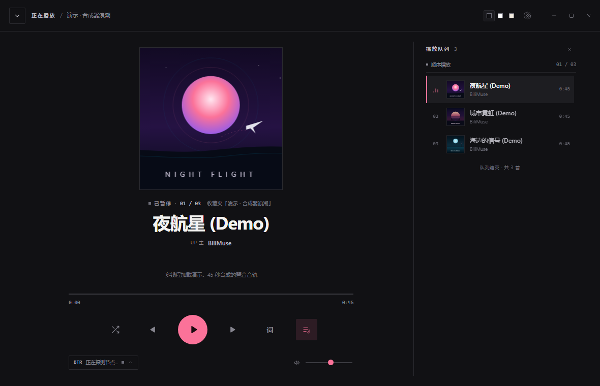
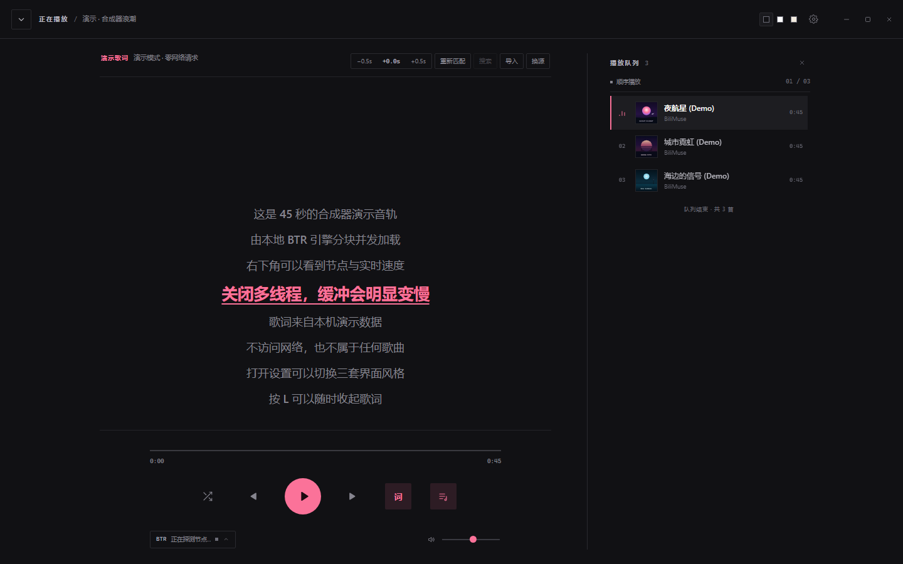

# 播放详情页

一块屏幕就能看完的 Now Playing。它没有新增接口，只是播放状态的另一种视图：
左侧是封面与走带，右侧是播放队列，BTR 遥测收进底部「传输详情」抽屉。桌面版与网页版
共用同一套页面；窗口不高时自动换成封面在左、走带在右的横向布局。



## 入口与退出

| 入口 | 行为 |
| --- | --- |
| 底部播放器左侧「正在播放」区域 | 打开 |
| 该区域右侧的展开按钮 | 打开 |
| 底部播放条右侧的队列键 | 打开详情页并展开播放队列 |
| `F` | 有曲目时打开 / 再按关闭 |
| `Esc`、左上角返回按钮 | 关闭（`Esc` 优先关闭传输详情 → 覆盖式队列 → 歌词搜索 → 歌词视图 → 页面） |
| `Q` | 展开 / 收起播放队列 |

未开始播放时入口置灰，点击不会打开空页面。打开后主界面与底部播放器设为 `inert`，
焦点落在走带的大播放键上；关闭后焦点回到打开前的元素。详情页有自己的顶栏，保留
Windows 无边框窗口的拖动区域与最小化 / 最大化 / 关闭按钮。

打开 / 关闭做 240ms 上浮淡入 / 160ms 下落淡出，不做封面飞行或版面对位；
`prefers-reduced-motion` 时直接显示 / 隐藏。

## 过渡与反馈动效

扁平语言下保留轻量的过渡：页面进入、首屏列表错峰、详情 / 歌词 / 队列切换都在
120–380ms 内，只动 `transform` / `opacity`，不触发布局重排。

| 场景 | 表现 |
| --- | --- |
| 应用启动 | 侧栏、顶栏、播放条按 20–60ms 间隔轻量落位（340–380ms） |
| 列表 / 队列 | 首屏前 12 行按 14ms（队列 12ms）错峰上浮；当前项播放头从顶部生长 |
| 主题切换 | 160ms 交叉淡入；Chromium / WebView2 走 View Transitions，旧内核直接切换 |
| 设置窗口 | 160ms 淡入 + 4px 上移；分类切换只做淡入 |
| 播放详情 | 打开时整页从底部上浮 3vh（封顶 32px）淡入，共 240ms；封面、信息、走带再按 20–180ms 延迟依次浮入；关闭 160ms 下落淡出；切歌时封面与文案轻量交叉 |
| 歌词 | 打开 220ms 淡入上浮；当前行颜色、字号与下划线平滑过渡 |
| 播放反馈 | 播放 / 暂停图标 120ms 交叉淡入；播放键按下 `scale(0.98)`；播放中右下角保留静态/动态均衡器 |
| 进度条 | 悬停出现 1px 预览线；拖动时旋钮显示，不做放大光环 |
| 窗口按钮 | 最大化 / 还原图标简单切换（仅 Windows 无边框窗口） |
| 启动页 | 标志、标题、状态依次淡入（约 460ms）；2px 粉色加载轨 900ms 循环；启动失败时停住 |

**降级与打断**：`prefers-reduced-motion: reduce` 时 CSS 动效与 JS 动效全部跳过；
设置窗口与详情页都用令牌作废迟到的异步回调。

`bilimuse/web/app.js` 顶部的 `motionAllowed()` 是 JS 侧唯一开关；`style.css` 的
“反馈动效”与“过渡动效”两段集中放入场、显隐规则与主题过渡。

## 布局

```
┌───────────────────────────────────────────────────────────────────────────┐
│ ⌄  正在播放 / 演示 · 合成器浪潮              ● ● ●    ⧉   ⚙    — □ ✕      │ 62
├───────────────────────────────────────────────────────────────────────────┤
│          ┌────────────────┐         播放队列  12                         │
│          │                │         ──────────────────────────────       │
│          │     封面 1:1    │         顺序播放                  01 / 03    │
│          │     （方图）     │         ● 夜航星 (Demo)             0:45    │
│          └────────────────┘           城市霓虹 (Demo)           0:45    │
│           正在播放 · 01 / 03           海边的信号 (Demo)         0:45    │
│           夜航星 (Demo)               ──────────────────────────────     │
│           UP 主 · BiliMuse           队列结束 · 共 3 首                  │
│           [演示音轨] [WAV] [BTR · 1 节点]                                 │
│           多线程加载演示：45 秒合成的器乐音轨（一行，窗口矮时隐藏）        │
│           0:01 ━━━━●────────────────────────────────────── 0:44          │
│              ⤨      ⏮       ▶       ⏭       ☰                           │
│           BTR 已缓冲 100% · 8 并发  ⌃            🔊 ─────●────            │
└───────────────────────────────────────────────────────────────────────────┘
                                  ↑ 点状态胶囊，从底部滑出传输详情
                                  ☰ 是播放队列键，播放键始终居中
```

### 顶栏

- 左侧：返回按钮、「正在播放」标签、当前收藏夹名（窄屏隐藏）。
- 右侧：当前主题的三个圆点、复制 B 站链接（演示模式隐藏）、播放引擎设置、
  窗口按钮。Win 下整条顶栏是拖动区域，按钮只吃自己的点击。
- 主题圆点与侧栏底部的主题开关是同一组控件：切到哪一套，全站立即生效。

### 封面

- 1:1 方图，`background-size: cover` 裁切视频封面；0 圆角、1px 内描边，像一张平放的唱片封套。
- 播放中时封面左缘出现 2px 粉色播放头。
- 尺寸随窗口缩放：`clamp(190px, min(37vh, 32vw), 380px)`；窗口变矮时先缩封面，
  再收起简介，最后切换到横向布局。
- B 站图片 CDN 拒绝 `Referer: http://127.0.0.1:...`（403）。页面在 `<head>` 统一声明
  `<meta name="referrer" content="no-referrer">`。
- 封面按显示尺寸请求 CDN 的 WebP 变体：列表 38px 缩略图约 3KB，当前曲目 560px 约
  20–30KB，而原图往往 200–500KB。`resolveCover()` 以「URL + 尺寸」缓存 Promise，
  底部播放器与详情页共用 560px 那一份，同帧换图。
- 加载失败自动退回原图，再失败才用主题化的品牌封面（唱片纹 + 音符），不会留下黑图。
- 悬浮时中央出现方形播放 / 暂停键；点击封面也可播放 / 暂停。
- 右下角三格跳动均衡器只在播放时出现。

### 曲目信息

- 一行微标签：状态点、「正在播放 / 已暂停」、`01 / 03`、来源收藏夹或搜索词。
- 标题最多两行，字号 `clamp(26px, 3vw, 38px)`、700 字重、字距 `-0.035em`。
- UP 主、音频 chips（音质、编码 / 码率、BTR 节点数）跟随主题；
  解析失败时 chips 变成可点击的「解析失败 · 点击重试」。
- 视频简介只留一行（`-webkit-line-clamp: 1`），窗口不高时整行隐藏。

### 走带

- 进度条支持拖动、点击、键盘左右键（5 秒）；悬停显示目标时间气泡。
- 三层信息：2px 粉色播放进度、灰色 `audio.buffered` 缓冲、下方 1px 细线表示 BTR 引擎
  已下载的字节比例。
- 中间是随机 / 上一首 / 播放暂停 / 下一首 / 播放队列五个键；两侧各两个等宽按钮，
  播放键正好落在走带中心。播放键是 B 站粉大圆、深色图标，暂停时两枚图标由 `.is-playing` 切换。
- 播放队列键在队列展开时点亮；窄屏下点它直接滑出队列抽屉。
- 底部一行：左侧「BTR 已缓冲 … · 8 并发」状态胶囊（点开传输详情），右侧音量滑杆。

## 播放队列

- 宽屏（≥ 1121px）是主舞台右侧的一栏；窄屏是从右侧滑出的覆盖式抽屉，默认收起，
  点走带最右侧的队列键或按 `Q` 打开，点遮罩 / `Esc` 收起。
- **顺序播放**：当前收藏夹已加载的曲目，播放位置跟随 `state.index`。
- **随机播放**：整个收藏夹（或全部搜索结果）的随机队列，队首是当前曲目；队列加载
  完成前标题显示「随机播放 · 正在整理收藏夹…」。
- 当前行：2px 粉色播放头、中性选中底、加粗标题、三格跳动均衡器；其余行悬停出现播放图标。
- 点击任意行直接切歌；顺序模式下等同于 `playIndex`，随机模式下移动队列指针。
- 队列可能有上千首，超过 240 首时只渲染当前附近的一段，首尾用「前面还有 N 首」
  「后面还有 N 首」说明；顺序模式还有未加载的页时，队尾提供「加载下一页」。
- 打开队列时会自动把当前行滚进视野中央。

## 传输详情（BTR 抽屉）

点走带左下角的状态胶囊，从底部滑出一张宽 920px 的抽屉；点遮罩、右上角关闭或 `Esc`
收起，焦点回到胶囊上。内容仍是原有遥测，只是不再占据主画面：

- 大数字：默认是实时缓冲速度；缓冲完成或暂停后切换为本次播放的**平均速度**，
  标签同步显示「实时缓冲 / 平均速度」。
- 速度曲线：最近 48 秒、每秒一个采样，用 1px 中性折线，不做渐变填充。
- 引擎已下载：按音轨字节数封顶；同一音轨被 Range 重取时服务端统计会累加，
  展示层不会显示超过 100% 的数字。
- 四个指标卡：并发连接、已完成分块、对冲 / 重试、已服务字节。
- CDN 节点列表：按实测速度排序，条宽为相对速度；悬停显示首字节耗时与失败次数。
- 单连接时给出说明；如果是用户关了 BTR，提供「开启 BTR」（下一首生效）。
- 「调整引擎参数」直接打开设置 → 播放引擎。

## 三套主题

| 主题 | 底色 | 正文 | 强调 | 气质 |
| --- | --- | --- | --- | --- |
| **墨 · 深色** | `#111114` | `#f4f3f1` | `#fb7299` | 近黑表面、1px 细线，默认 |
| **纸 · 浅色** | `#ffffff` | `#17171a` | `#b4235a` 文字 / `#d63669` 轨 | 纯白表面、清晰克制 |
| **米 · 暖调** | `#f2ebdf` | `#1b1a17` | `#b4235a` 文字 / `#d63669` 轨 | 暖纸底色、夜晚小音量 |

- 切换入口：侧栏底部「界面风格」、详情页顶栏的三个圆点、设置 → 外观。
- 主题由 `<html data-theme="ink|paper|cream">` 驱动，颜色、细线、滚动条、SVG 图表
  全部走 CSS 变量；粉色只用于播放、进度、选中项与主按钮。
- 完整令牌与对比度规则见 [DESIGN.md](DESIGN.md)。
- 首帧主题由服务端在返回 `index.html` 时直接注入 `<html data-theme>`（桌面版每次启动
  端口随机，localStorage 不能当唯一真源）；静态打开页面时由 `<head>` 内联脚本读
  localStorage 兜底。切换后同步写回 `settings.json` 与 localStorage，并更新
  `<meta name="theme-color">`。
- 界面不使用噪点、阴影或背景渐变；大面积纯色由 1px 细线与排版层级支撑。

## 状态覆盖

| 状态 | 表现 |
| --- | --- |
| 音轨解析中 | chips 显示 spinner；传输详情「正在探测 CDN 节点…」 |
| 播放 / 暂停 | 走带图标、封面悬浮键、状态点、队列均衡器、播放键同步 |
| 解析失败 | chips 变成可点击的「解析失败 · 点击重试」 |
| 无封面 | 纯色方封面 + 深色音符，不发光、不虚化 |
| 单连接 | 质量 chip 显示「单连接」；抽屉内说明与可选开关 |
| 队列为空 | 面板内空状态文案（切换收藏夹后可能出现） |
| 长队列 | 只渲染当前附近 240 首，首尾提示剩余数量 |

## 键盘

| 按键 | 行为 |
| --- | --- |
| `F` | 打开 / 关闭详情页 |
| `Esc` | 依次关闭传输详情 → 覆盖式队列 → 歌词搜索 → 歌词视图 → 详情页 |
| `Q` | 展开 / 收起播放队列 |
| `Space` | 播放 / 暂停（焦点在按钮上时交给按钮本身） |
| `←` / `→` | 快退 / 快进 5 秒；焦点在进度条上时只执行一次 |
| `N` / `P` | 下一首 / 上一首 |
| `S` | 随机播放 |
| `Tab` / `Shift+Tab` | 焦点锁在详情页内循环（含已展开的抽屉） |
| `Ctrl/⌘ + K` | 关闭详情页并聚焦收藏夹搜索 |

进度条 `role="slider"`，带 `aria-valuenow`；队列开关带 `aria-expanded`；
传输详情的关闭按钮在展开时自动获得焦点。

## 数据来源

| 数据 | 来源 |
| --- | --- |
| 标题、UP 主、时长、封面、简介 | 收藏夹分页的列表项，`state.nowTrack` 在音轨解析前就可渲染 |
| 音质、编码、码率、大小、引擎模式、节点数 | `POST /api/track` |
| 实时速度、分块、缓冲、对冲、重试、节点速度 | `GET /api/stats/:id`，播放时每秒一次 |
| 播放进度 / 缓冲 | `<audio>` 的 `timeupdate` / `progress` 事件 |
| 歌词、来源标签、匹配信息、偏移 | `GET /api/lyrics/:bvid` 解析，`POST /api/lyrics/:bvid/prefs` 保存偏移与锁定；只在歌词视图打开时请求 |

暂停时停止轮询，保留最后一帧；重新播放会继续刷新。切换音轨会清空上一首的 BTR 快照，
旧请求返回后通过 `id` 比对丢弃。

## 歌词



播放详情页可以整页切到同步歌词：走带里的「词」键（`#np-lyrics-btn`）或键盘 `L` 切换，
点击封面仍是原来的播放 / 暂停。歌词视图占据封面与曲目信息的位置，进度条、走带、底部状态
和右侧播放队列都保持原样；再按「词」或 `L` 回到封面视图。打开详情页时始终以封面视图进入，
关闭详情页也会复位歌词状态。

布局：

- 宽屏歌词区最大宽度 720px；当前行放大并带 2px 粉色播放头，非当前行用 muted 全不透明；
  上下用 1px 细线收边，不再是渐隐遮罩。
- 窗口高度 ≤ 620px 且宽度 ≥ 821px（如 880×560）时切回单列，歌词区最小高度 150px，
  保证矮窗下仍可操作；≤ 820px 窄屏同样是单列。
- 歌词行随播放位置自动滚动；用户手动滚动后暂停跟随并出现「回到当前」，点它或切歌后恢复。
  点任意一行把播放位置跳到该行时间（含偏移）。

`Esc` 依次关闭传输详情 → 覆盖式队列 → 歌词搜索面板 → 歌词视图 → 详情页。

数据来源与偏移：

- 来源阶梯：本地 LRC → 用户锁定的来源 → B 站人工字幕 → LRCLIB（得分 ≥ 0.62）→
  B 站 AI 字幕 → 无。界面始终显示来源标签与 LRCLIB 匹配到的歌名 / 歌手，选错时可以换源。
- 接口：`GET /api/lyrics/:bvid` 解析，`POST /api/lyrics/:bvid/prefs` 保存偏移与锁定；
  另有 `/sources`、`/search`、`/use` 与本地 LRC 的导入 / 删除接口。
- 偏移单位秒、范围 ±30s、步进 0.5s（`[` / `]` 或界面按钮），按 bvid 持久化；只有同步歌词
  才显示偏移控件。LRCLIB 命中且本视频有字幕时，会用字幕自动校准整首偏移，偏移区显示
  「自动校准」徽标；手动 ±0.5s 后徽标变为「手动」，点徽标可恢复自动校准。
- 只有打开歌词视图时才请求；失败、超时或没有可用来源只显示空状态，播放链路不受影响。

完整契约与清洗、打分规则见 [LYRICS.md](LYRICS.md)。

## 响应式

| 窗口 | 处理 |
| --- | --- |
| ≥ 1121px | 封面 + 走带在左，队列栏在右；队列收起时走带居中 |
| 821–1120px | 队列变成右侧覆盖抽屉；其余保持竖排 |
| ≤ 820px | 单列：封面 → 信息 → 走带；顶栏标签收窄，主题圆点隐藏（到设置里切换） |
| 高度 ≤ 700px | 隐藏简介，缩小封面与间距 |
| 高度 ≤ 620px 且宽度 ≥ 821px | 横向布局：封面在左，信息 / 进度 / 走带成组在右 |
| 高度 ≤ 620px 且宽度 ≤ 820px | 单列紧凑：封面缩小、简介隐藏 |

内容最大宽度 1240px；宽屏时舞台居中。背景为纯色 `--bg`，不再有封面模糊环境光。

## 文件

- `bilimuse/web/index.html`：主题初始化脚本、`#now-playing` 结构、设置里的外观面板；
- `bilimuse/web/style.css`：顶部主题令牌、`/* 播放详情 */` 段落、`/* 反馈动效 */` 与
  `/* 过渡动效 */` 段落（入场、列表错峰、内容切换与按压反馈）；
- `bilimuse/web/app.js`：`applyTheme` / `persistTheme` / `chooseTheme`，`motionAllowed()` /
  `restartClass()`，`npSetQueue` / `npSetEngine`，`npRender*` 系列，以及 `playTrackNow` /
  `refreshStats` / `updateShuffleUi` 的同步钩子；
- `bilimuse/config.py`、`bilimuse/server.py`：`theme` 的持久化与 `/api/settings` 校验；
- 验收截图：[队列](../assets/playback-queue.png)、[传输详情](../assets/playback-engine.png)、
  [880×560 横向布局](../assets/playback-compact.png)。

## 视觉规范

设计语言与完整令牌见 [DESIGN.md](DESIGN.md)。

| 项 | 值 |
| --- | --- |
| 字体 | 系统 UI 字体（Segoe UI / PingFang SC / 微软雅黑）；数字与时间用等宽字体 |
| 标题 | `clamp(26px, 3vw, 38px)` / 700 字重 / `-0.035em` 字距 |
| 微标签 | 10px / 600 字重 / 大写 / 字距 0.16em |
| 数字 | `font-variant-numeric: tabular-nums` |
| 圆角 | 封面 / 面板 / 弹窗 0；按钮 / 输入 / chip 2px；播放键与进度 knob 全圆 |
| 间距 | 8 / 12 / 16 / 24 / 34；舞台左右 `clamp(22px, 4vw, 48px)` |
| 分割线 | 1px `--line` / `--line-soft`，不用阴影分层 |
| 粉色 | `#FB7299` 只用于播放态、进度、选中项、主按钮、当前歌词与焦点环 |
| 动效 | 120–240ms，只动 transform / opacity；详情打开 / 关闭为 240ms 上浮淡入与 160ms 下落淡出；`prefers-reduced-motion` 时全部跳过 |
