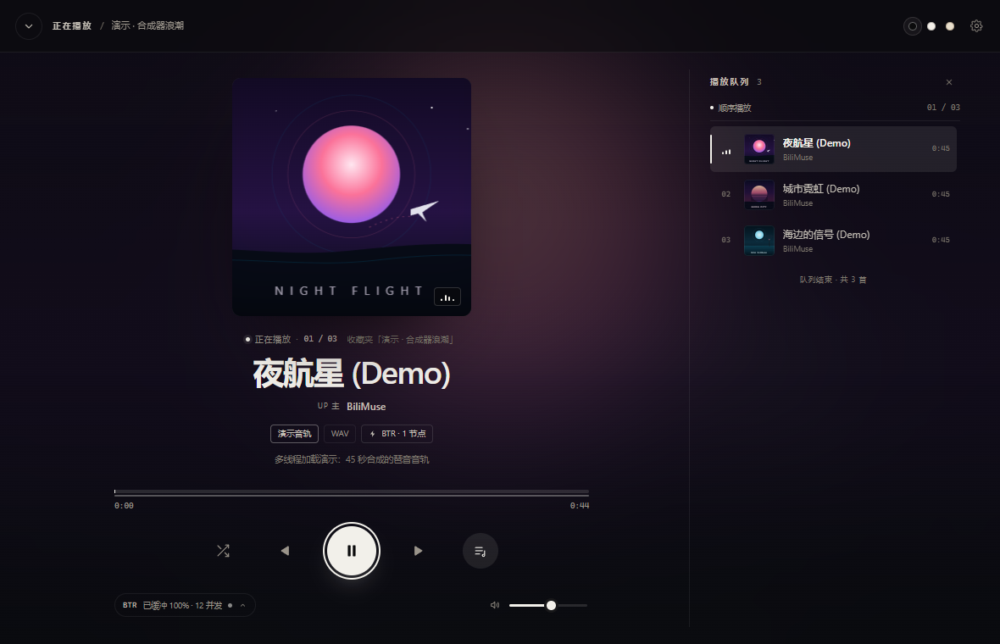

# 播放详情页

一块屏幕就能看完的 Now Playing。它没有新增接口，只是播放状态的另一种视图：
左侧是封面与走带，右侧是播放队列，BTR 遥测收进底部「传输详情」抽屉。桌面版与网页版
共用同一套页面；窗口不高时自动换成封面在左、走带在右的横向布局。



## 入口与退出

| 入口 | 行为 |
| --- | --- |
| 底部播放器左侧「正在播放」区域 | 打开 |
| 该区域右侧的展开按钮 | 打开 |
| 底部播放条右侧的队列键 | 打开详情页并展开播放队列 |
| `F` | 有曲目时打开 / 再按关闭 |
| `Esc`、左上角返回按钮 | 关闭（优先关闭传输详情 → 覆盖式队列 → 页面） |
| `Q` | 展开 / 收起播放队列 |

未开始播放时入口置灰，点击不会打开空页面。打开后主界面与底部播放器设为 `inert`，
焦点落在走带的大播放键上；关闭后焦点回到打开前的元素。详情页有自己的顶栏，保留
Windows 无边框窗口的拖动区域与最小化 / 最大化 / 关闭按钮。

## 布局

```
┌───────────────────────────────────────────────────────────────────────────┐
│ ⌄  正在播放 / 演示 · 合成器浪潮              ● ● ●    ⧉   ⚙    — □ ✕      │ 62
├───────────────────────────────────────────────────────────────────────────┤
│          ┌────────────────┐         播放队列  12                         │
│          │                │         ──────────────────────────────       │
│          │     封面 1:1    │         顺序播放                  01 / 03    │
│          │     （方图）     │         ● 夜航星 (Demo)             0:45    │
│          └────────────────┘           城市霓虹 (Demo)           0:45    │
│           正在播放 · 01 / 03           海边的信号 (Demo)         0:45    │
│           夜航星 (Demo)               ──────────────────────────────     │
│           UP 主 · BiliMuse           队列结束 · 共 3 首                  │
│           [演示音轨] [WAV] [BTR · 1 节点]                                 │
│           多线程加载演示：45 秒合成的器乐音轨（一行，窗口矮时隐藏）        │
│           0:01 ━━━━●────────────────────────────────────── 0:44          │
│              ⤨      ⏮       ▶       ⏭       ☰                           │
│           BTR 已缓冲 100% · 8 并发  ⌃            🔊 ─────●────            │
└───────────────────────────────────────────────────────────────────────────┘
                                  ↑ 点状态胶囊，从底部滑出传输详情
                                  ☰ 是播放队列键，播放键始终居中
```

### 顶栏

- 左侧：返回按钮、「正在播放」标签、当前收藏夹名（窄屏隐藏）。
- 右侧：当前主题的三个圆点、复制 B 站链接（演示模式隐藏）、播放引擎设置、
  窗口按钮。Win 下整条顶栏是拖动区域，按钮只吃自己的点击。
- 主题圆点与侧栏底部的主题开关是同一组控件：切到哪一套，全站立即生效。

### 封面

- 1:1 方图，`background-size: cover` 裁切视频封面；圆角 10px，发丝内描边 + 大投影，
  像从唱片套里抽出来的一张方封套。
- 尺寸随窗口缩放：`clamp(190px, min(37vh, 32vw), 380px)`；窗口变矮时先缩封面，
  再收起简介，最后切换到横向布局。
- 封面外圈的环境光是同一张封面的放大虚化，铺满页面，透明度按主题收敛（墨 26%、
  纸 10%、米 13%）——页面里唯一的颜色来自封面。
- B 站图片 CDN 拒绝 `Referer: http://127.0.0.1:...`（403）。页面在 `<head>` 统一声明
  `<meta name="referrer" content="no-referrer">`。
- 封面按显示尺寸请求 CDN 的 WebP 变体：列表 38px 缩略图约 3KB，当前曲目 560px 约
  20–30KB，而原图往往 200–500KB。`resolveCover()` 以「URL + 尺寸」缓存 Promise，
  底部播放器与详情页共用 560px 那一份，同帧换图。
- 加载失败自动退回原图，再失败才用主题化的品牌封面（唱片纹 + 音符），不会留下黑图。
- 悬浮时封面轻微放大，中央出现半透明播放 / 暂停键；点击封面也可播放 / 暂停。
- 右下角三格跳动均衡器只在播放时出现。

### 曲目信息

- 一行微标签：状态点、「正在播放 / 已暂停」、`01 / 03`、来源收藏夹或搜索词。
- 标题最多两行，字号 `clamp(26px, 3.1vw, 38px)`，字距收紧。
- UP 主、音频 chips（音质、编码 / 码率、BTR 节点数）跟随主题；
  解析失败时 chips 变成可点击的「解析失败 · 点击重试」。
- 视频简介只留一行（`-webkit-line-clamp: 1`），窗口不高时整行隐藏。

### 走带

- 进度条支持拖动、点击、键盘左右键（5 秒）；悬停显示目标时间气泡。
- 三层信息：主题前景色播放进度、灰色 `audio.buffered` 缓冲、下方细线表示 BTR 引擎
  已下载的字节比例。
- 中间是随机 / 上一首 / 播放暂停 / 下一首 / 播放队列五个键；两侧各两个等宽按钮，
  播放键正好落在走带中心。播放键是主题反色的大圆，暂停时两枚图标由 `.is-playing` 切换。
- 播放队列键在队列展开时点亮；窄屏下点它直接滑出队列抽屉。
- 底部一行：左侧「BTR 已缓冲 … · 8 并发」状态胶囊（点开传输详情），右侧音量滑杆。

## 播放队列

- 宽屏（≥ 1121px）是主舞台右侧的一栏；窄屏是从右侧滑出的覆盖式抽屉，默认收起，
  点走带最右侧的队列键或按 `Q` 打开，点遮罩 / `Esc` 收起。
- **顺序播放**：当前收藏夹已加载的曲目，播放位置跟随 `state.index`。
- **随机播放**：整个收藏夹（或全部搜索结果）的随机队列，队首是当前曲目；队列加载
  完成前标题显示「随机播放 · 正在整理收藏夹…」。
- 当前行：主题色左侧指示条、加粗标题、三格跳动均衡器；其余行悬停出现播放图标。
- 点击任意行直接切歌；顺序模式下等同于 `playIndex`，随机模式下移动队列指针。
- 队列可能有上千首，超过 240 首时只渲染当前附近的一段，首尾用「前面还有 N 首」
  「后面还有 N 首」说明；顺序模式还有未加载的页时，队尾提供「加载下一页」。
- 打开队列时会自动把当前行滚进视野中央。

## 传输详情（BTR 抽屉）

点走带左下角的状态胶囊，从底部滑出一张宽 920px 的抽屉；点遮罩、右上角关闭或 `Esc`
收起，焦点回到胶囊上。内容仍是原有遥测，只是不再占据主画面：

- 大数字：默认是实时缓冲速度；缓冲完成或暂停后切换为本次播放的**平均速度**，
  标签同步显示「实时缓冲 / 平均速度」。
- 速度曲线：最近 48 秒、每秒一个采样，用主题色的渐变描边 + 半透明面积。
- 引擎已下载：按音轨字节数封顶；同一音轨被 Range 重取时服务端统计会累加，
  展示层不会显示超过 100% 的数字。
- 四个指标卡：并发连接、已完成分块、对冲 / 重试、已服务字节。
- CDN 节点列表：按实测速度排序，条宽为相对速度；悬停显示首字节耗时与失败次数。
- 单连接时给出说明；如果是用户关了 BTR，提供「开启 BTR」（下一首生效）。
- 「调整引擎参数」直接打开设置 → 播放引擎。

## 三套主题

| 主题 | 底色 | 正文 | 强调 | 气质 |
| --- | --- | --- | --- | --- |
| **墨 · 黑白** | `#0b0b0c` | `#f2f0ea` 纸白 | 纸白 | 黑胶封套背面，默认 |
| **纸 · 黑白** | `#f4f1ea` 米白 | `#17140f` 墨色 | 墨色 | 白天 / 纸面阅读 |
| **米 · 暖调** | `#ebe0cd` 亚麻 | `#2a2118` 深咖 | `#8b4a28` 锈红 | 夜晚小音量 |

- 切换入口：侧栏底部「界面风格」、详情页顶栏的三个圆点、设置 → 外观。
- 主题由 `<html data-theme="ink|paper|cream">` 驱动，颜色、阴影、发丝线、滚动条、
  SVG 图表全部走 CSS 变量；只有封面与环境光是彩色的。
- 首帧主题由服务端在返回 `index.html` 时直接注入 `<html data-theme>`（桌面版每次启动
  端口随机，localStorage 不能当唯一真源）；静态打开页面时由 `<head>` 内联脚本读
  localStorage 兜底。切换后同步写回 `settings.json` 与 localStorage，并更新
  `<meta name="theme-color">`。
- 界面带有极轻的纸纹噪点（墨色主题 2.8%，纸 / 米色主题把噪点作为 multiply 叠加），
  避免大面积纯色显得单薄。

## 状态覆盖

| 状态 | 表现 |
| --- | --- |
| 音轨解析中 | chips 显示 spinner；传输详情「正在探测 CDN 节点…」 |
| 播放 / 暂停 | 走带图标、封面悬浮键、状态点、队列均衡器、播放键同步 |
| 解析失败 | chips 变成可点击的「解析失败 · 点击重试」 |
| 无封面 | 主题化品牌封面（唱片纹 + 音符）；环境光回到主题柔光 |
| 单连接 | 质量 chip 显示「单连接」；抽屉内说明与可选开关 |
| 队列为空 | 面板内空状态文案（切换收藏夹后可能出现） |
| 长队列 | 只渲染当前附近 240 首，首尾提示剩余数量 |

## 键盘

| 按键 | 行为 |
| --- | --- |
| `F` | 打开 / 关闭详情页 |
| `Esc` | 依次关闭传输详情 → 覆盖式队列 → 详情页 |
| `Q` | 展开 / 收起播放队列 |
| `Space` | 播放 / 暂停（焦点在按钮上时交给按钮本身） |
| `←` / `→` | 快退 / 快进 5 秒；焦点在进度条上时只执行一次 |
| `N` / `P` | 下一首 / 上一首 |
| `S` | 随机播放 |
| `Tab` / `Shift+Tab` | 焦点锁在详情页内循环（含已展开的抽屉） |
| `Ctrl/⌘ + K` | 关闭详情页并聚焦收藏夹搜索 |

进度条 `role="slider"`，带 `aria-valuenow`；队列开关带 `aria-expanded`；
传输详情的关闭按钮在展开时自动获得焦点。

## 数据来源

| 数据 | 来源 |
| --- | --- |
| 标题、UP 主、时长、封面、简介 | 收藏夹分页的列表项，`state.nowTrack` 在音轨解析前就可渲染 |
| 音质、编码、码率、大小、引擎模式、节点数 | `POST /api/track` |
| 实时速度、分块、缓冲、对冲、重试、节点速度 | `GET /api/stats/:id`，播放时每秒一次 |
| 播放进度 / 缓冲 | `<audio>` 的 `timeupdate` / `progress` 事件 |

暂停时停止轮询，保留最后一帧；重新播放会继续刷新。切换音轨会清空上一首的 BTR 快照，
旧请求返回后通过 `id` 比对丢弃。

## 为什么没有歌词

B 站收藏夹里是视频，音轨本身没有歌词数据源。与其伪造一段假歌词，不如把主画面留给
封面和走带，把真正独有的东西——播放队列与 BTR 遥测——放进侧栏和抽屉。将来如果接入
歌词，只需在窄屏把队列抽屉换成歌词抽屉，舞台布局不需要改。

## 响应式

| 窗口 | 处理 |
| --- | --- |
| ≥ 1121px | 封面 + 走带在左，队列栏在右；队列收起时走带居中 |
| 821–1120px | 队列变成右侧覆盖抽屉；其余保持竖排 |
| ≤ 820px | 单列：封面 → 信息 → 走带；顶栏标签收窄，主题圆点隐藏（到设置里切换） |
| 高度 ≤ 700px | 隐藏简介，缩小封面与间距 |
| 高度 ≤ 620px 且宽度 ≥ 821px | 横向布局：封面在左，信息 / 进度 / 走带成组在右 |
| 高度 ≤ 620px 且宽度 ≤ 820px | 单列紧凑：封面缩小、简介隐藏 |

内容最大宽度 1240px；宽屏时舞台居中，环境光仍铺满整窗。

## 文件

- `bilimuse/web/index.html`：主题初始化脚本、`#now-playing` 结构、设置里的外观面板；
- `bilimuse/web/style.css`：顶部主题令牌、`/* 播放详情 */` 段落；
- `bilimuse/web/app.js`：`applyTheme` / `persistTheme`，`npSetQueue` / `npSetEngine`，
  `npRender*` 系列，以及 `playTrackNow` / `refreshStats` / `updateShuffleUi` 的同步钩子；
- `bilimuse/config.py`、`bilimuse/server.py`：`theme` 的持久化与 `/api/settings` 校验；
- 验收截图：[队列](../assets/playback-queue.png)、[传输详情](../assets/playback-engine.png)、
  [880×560 横向布局](../assets/playback-compact.png)。

## 视觉规范

| 项 | 值 |
| --- | --- |
| 字体 | 系统 UI 字体（Segoe UI / PingFang SC / 微软雅黑）；数字与时间用等宽字体 |
| 标题 | `clamp(26px, 3.1vw, 38px)` / 620 字重 / `-0.03em` 字距 |
| 微标签 | 9.5–10.5px，大写 / 字距 0.14–0.2em |
| 数字 | `font-variant-numeric: tabular-nums` |
| 圆角 | 封面 10、队列行 6、抽屉 14、播放键全圆 |
| 间距 | 8 / 12 / 16 / 24 / 34；舞台左右 `clamp(22px, 4vw, 48px)` |
| 分割线 | 1px `--line-soft`，墨色 7%、纸色 7.5%、米色 9% 不透明度 |
| 动效 | 入场 300ms、抽屉 240ms、均衡器 0.95–1.1s；`prefers-reduced-motion` 时全部停止 |
